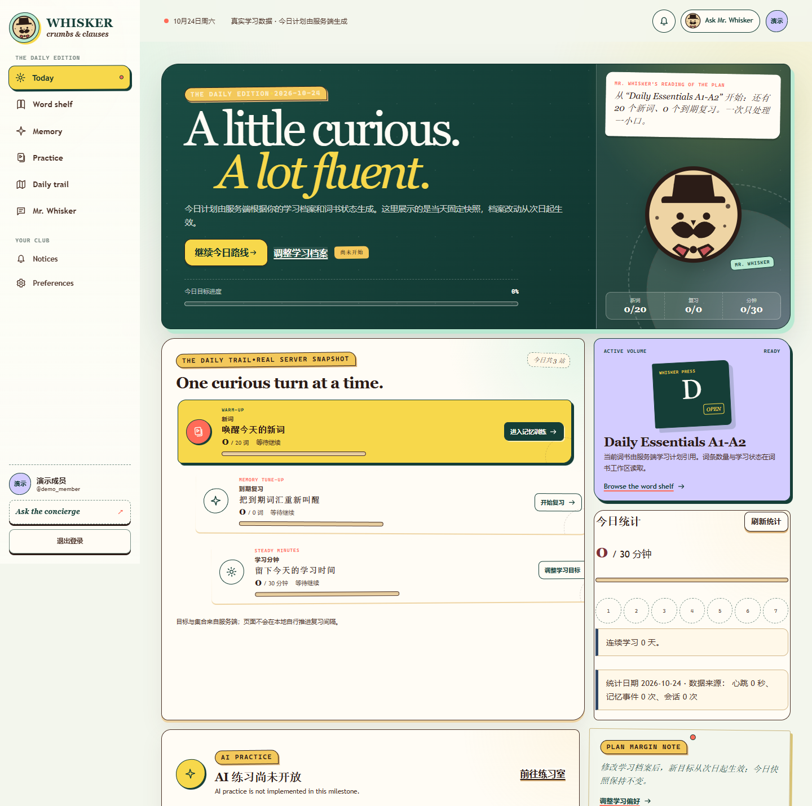
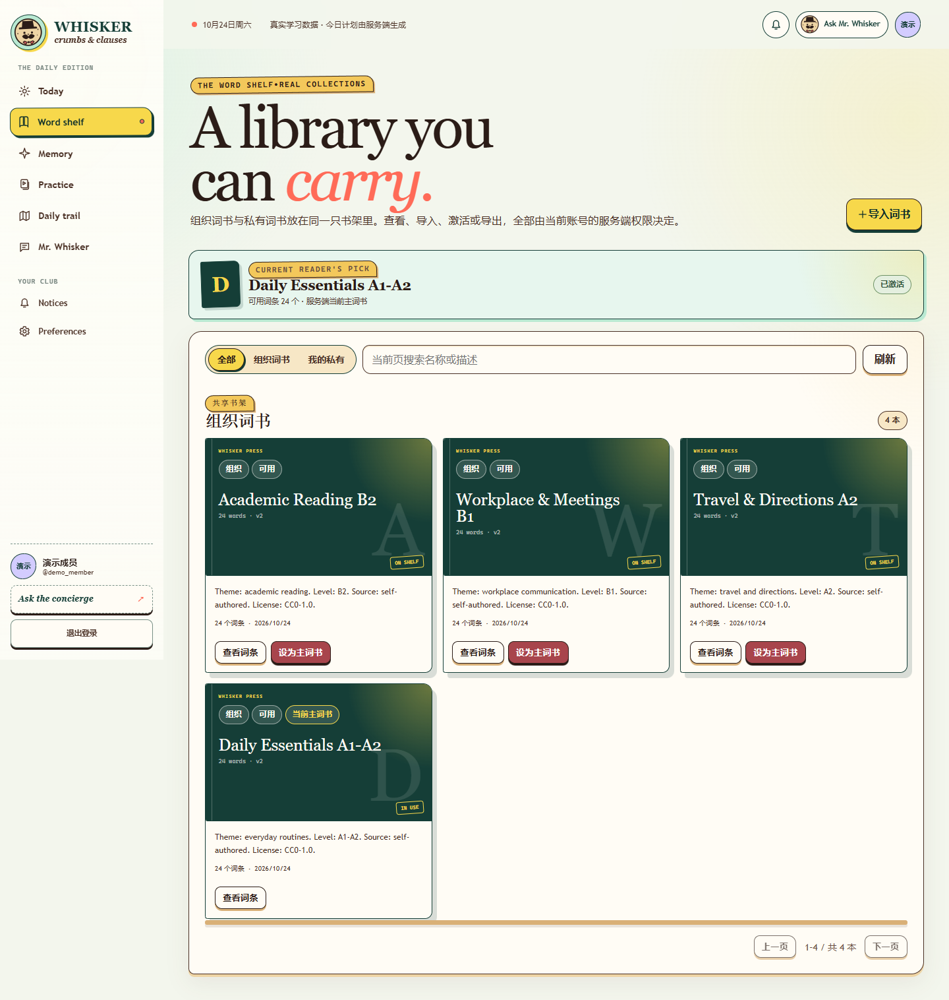
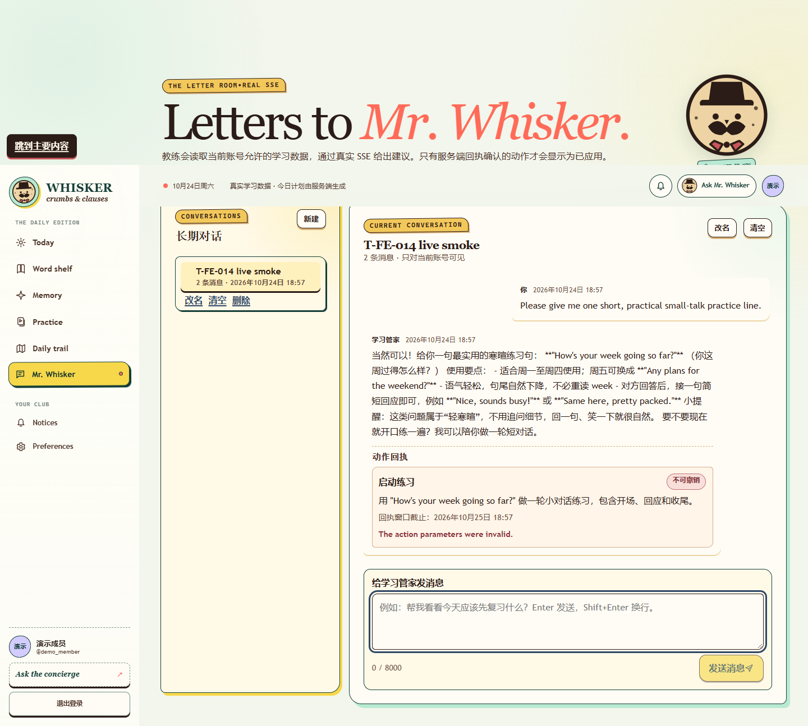

# 演示截图与事实清单

- 当前预览：`http://23.94.141.170:18080`（`v0.1.2`，commit `8d5cb83`；HTTP）
- 主题：Whisker Crumb
- 成员端结构：`member-rail`、`member-topbar`、移动导航、Word shelf、Practice room、Mr. Whisker
- 预览账号：`demo_admin`、`demo_member`；密码只从 A40 的 ACL 本地凭据文件安全获取
- 数据性质：合成管理员/成员/词书/练习/对话/挑战数据
- 用途：比赛材料与事实核对；不是稳定 HTTPS 截图，不代表最终 MVP PASS

## 1. v0.1.2 真实预览截图

来源：T-SHIP-004 真实浏览器验收，`test-artifacts/T-SHIP-004-20261024/racknerd/screenshots/`。

| 文件 | 分辨率 | SHA256 | 事实 |
|---|---:|---|---|
| `v0.1.2-desktop-login.png` | 1440×1000 | `85A3B32033F318FD67AF536652D28B5A686CE6835A52817F2C1E18AD22285B9F` | Whisker Crumb 登录页 |
| `v0.1.2-desktop-today.png` | 1440×1430 | `36E9EB2E0FCB98B926E75FEFC74069E753D925655E20293231C1989DFE1330A7` | 成员 Today 新骨架、真实 `/learning/today` 数据 |
| `v0.1.2-desktop-word-shelf.png` | 1440×1516 | `B4F6A90AB810582572CFC307A3B42A47DBB00001BB14F2216EE707E68D213002` | Word shelf 实体书卡、真实词书数据 |
| `v0.1.2-desktop-practice-room.png` | 1440×1199 | `2C2BBBB18296B6DE3D08D11B0986C265AE119B77032659B35BAF77F6E53BA98C` | Practice room、真实额度/记录/词书 |
| `v0.1.2-desktop-mr-whisker.png` | 1440×1294 | `43E2930D7F0C4DD8C66020084AFA576D5F3368EE9BD0398DC2872EA52D16607C` | Mr. Whisker 信件房、真实教练会话 |
| `v0.1.2-mobile390-today.png` | 390×3412 | `08DA44DFE4397842E1634CE80421A57C84E45F5CF28922FACD1BF92C9804605E` | 390px 移动 Today 与底部导航 |
| `v0.1.2-desktop-admin-dashboard.png` | 1440×1000 | `52DD82F618E191ECD656DE0A38AF3CBA3FEB3F1406A7D286FD885A6881377E97` | 管理员组织看板、真实聚合数据 |

## 2. 历史 QA 功能截图

以下 9 张来自 T-QA-004 的 QA/受控环境，保留用于 AI provider、练习、通知、教练和 BOSS 功能证据；它们不是当前 v0.1.2 公网结构截图。

| 文件 | 分辨率 | SHA256 | 事实 |
|---|---:|---|---|
| `admin-ai-provider.png` | 1440×1524 | `B1B2EE0B540E2834EC751F7E875D38F6B2A6150A4F7529632037F48F6B05869B` | AI provider 配置、Key 掩码 |
| `admin-ai-prompt.png` | 1440×1296 | `A310FE6DD931A3AAF1AEA311D0EEDCFC3440A095E96FFE00B24F9077C411FB81` | 提示词读取/覆盖 |
| `practice-result.png` | 1440×1771 | `A74BA16E4665A37F3DADC3E958E3EBC95C6BCEC2E9611535B7F0B84C109981B3` | AI 练习提交后结果与解析 |
| `practice-failure.png` | 1440×1000 | `BEAA264745CEC6CA386D49E817D9BF8934B01E4C18F29F879C8934F3B31C5E0E` | provider 失败态、真实错误 |
| `notifications.png` | 1440×1288 | `226FBA18E400C0A039E6AE85E4372E38E24D1F3832D342AE1D50C4D0D20CCCEE` | 通知收件箱与未读 |
| `dashboard-aggregate.png` | 1440×2335 | `E85EA6FF7B831190BA18E81638762D1FE651EE0C1661F8CDF35DFFA5B1FB5A3F` | 组织聚合看板（QA） |
| `coach-action.png` | 1440×1105 | `A50D65FE624A03B211ABC444EED4BC20FE8F445A1A02BD64235C82EDA4713DB4` | 教练 SSE 与 action receipt |
| `challenge-boss-result.png` | 1440×2129 | `79F446C899FD6B8F9B7161C9380108AC2951A5C39E7DAD232DD413269B87AD16` | BOSS 结果可见 |
| `challenge-boss-reenter.png` | 1440×2535 | `425D9F9CF85EB9E173320ECD250704154628AC889BFEDE2C92AF5055612F9EB6` | 刷新后重入结果 |

## 3. 安全与来源

- v0.1.2 截图来自真实 Chrome + Playwright，使用真实 API 数据和合成账号。
- T-SHIP-004 记录：7 张截图、6 条浏览器路由、page errors 0、request failures 0、external requests 0；登录前预期未认证 refresh 401 不计入异常。
- 截图不含表单输入的密码、Token、Cookie 或真实成员数据。
- 临时预览是 HTTP，不是稳定 HTTPS；HSTS 响应头不能替代 HTTPS。
- 公网截图已在 A40 ACL 凭据授权下捕获；不得把密码、Cookie 或 Token 写入截图或仓库。
- 稳定 HTTPS 截图和最终比赛视频仍为 TODO。

## 4. 证据

- `ai-workspace/10-collaboration/reports/T-SHIP-004-SHIP.md`
- `ai-workspace/10-collaboration/reports/T-FE-014-VIEW.md`
- `ai-workspace/10-collaboration/sessions/A40-SHIP/test-artifacts/T-SHIP-004-20261024/racknerd/visual-evidence.json`
- `ai-workspace/10-collaboration/sessions/A40-SHIP/test-artifacts/T-SHIP-004-20261024/racknerd/public-smoke.json`
- `ai-workspace/10-collaboration/sessions/A40-SHIP/test-artifacts/T-SHIP-004-20261024/racknerd/screenshots/`
- 历史功能证据：`ai-workspace/04-qa/evidence/T-QA-004/`

## 5. 当前限制

- 截图不是最终比赛视频，也不能单独证明稳定 HTTPS、长期生产 SLA 或最终 MVP。
- Today 页面 `ai_practice` 仍是旧 `not_available` 字段；AI 练习从 `/practice` 展示。
- 管理员端本轮只做不回归检查，没有重做页面结构。
- 预览环境的健康、登录、SSE、备份和回滚证据以 T-SHIP-004 为准，不以截图替代。
