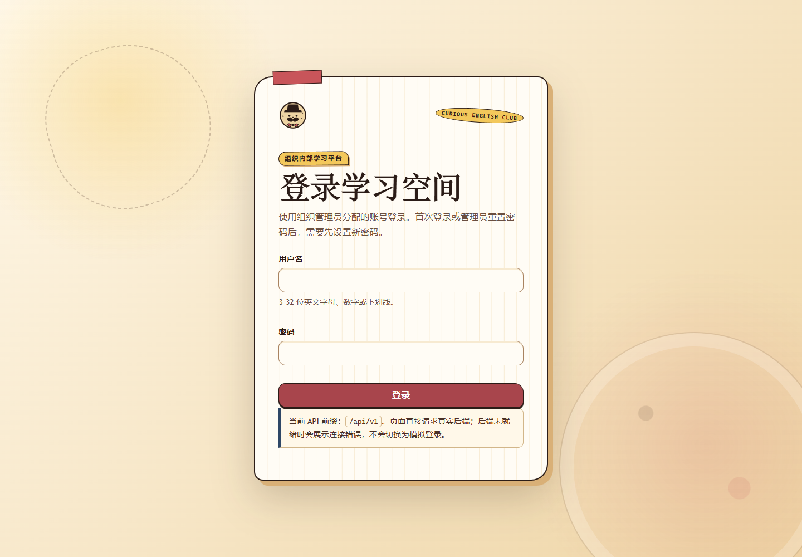
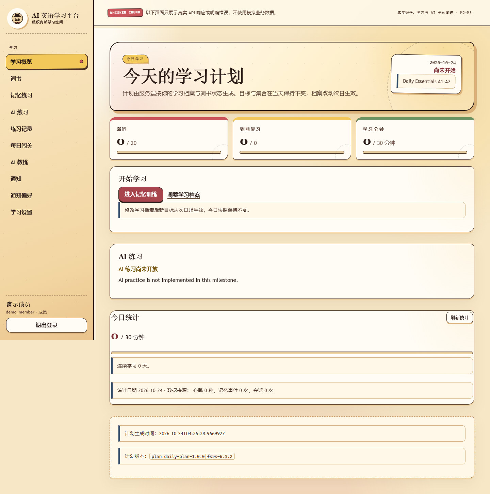
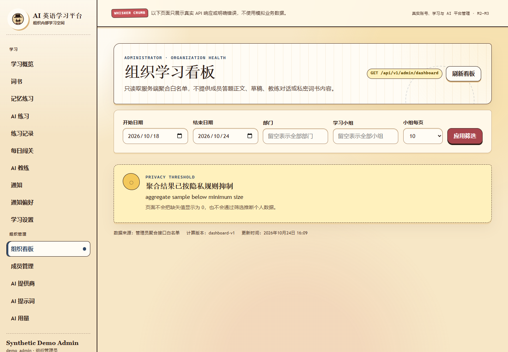

# 演示截图与事实清单

- 当前预览：`http://23.94.141.170:18080`（`v0.1.1`，commit `a6ac195`；HTTP）
- 主题：Whisker Crumb
- 预览账号：`demo_admin`、`demo_member`；密码只从 A40 的 ACL 本地凭据文件安全获取
- 数据性质：合成管理员/成员/词书/练习/对话/挑战数据
- 用途：比赛材料与事实核对；不是稳定 HTTPS 截图，不代表最终 MVP PASS

## 1. v0.1.1 真实预览截图

来源：T-SHIP-003 真实浏览器验收，`test-artifacts/T-SHIP-003-20261024/racknerd/screenshots/`。

| 文件 | 分辨率 | SHA256 | 事实 |
|---|---:|---|---|
| `v0.1.1-desktop-login.png` | 1440×1000 | `85A3B32033F318FD67AF536652D28B5A686CE6835A52817F2C1E18AD22285B9F` | Whisker Crumb 登录页 |
| `v0.1.1-desktop-member-overview.png` | 1440×1453 | `BEDDEFA142922213FB696679E085987194F711D551E4C3F442928D90D2BF0BEE` | 成员今日概览、真实 API 数据 |
| `v0.1.1-desktop-member-wordbooks.png` | 1440×1300 | `E7D01693FD2ED76E2CCA16E2D0D1EA03D28A48FB1988F1572145E25CAC83B9D9` | 成员词书页 |
| `v0.1.1-mobile390-member-overview.png` | 390×2439 | `AA2E79F13AF690457C47878D1503BC67FDAD27046CB3FD5A6DED0395CC0BA7E9` | 移动端成员概览 |
| `v0.1.1-desktop-admin-dashboard.png` | 1440×1000 | `168ACDB7C786E0CFDA7F44860539D107A97C457556FDE56A7475EB67EC07F99B` | 管理员组织看板 |

## 2. 历史 QA 功能截图

以下 9 张来自 T-QA-004 的 QA/受控环境，保留用于 AI provider、练习、通知、教练和 BOSS 功能证据；它们不是当前 v0.1.1 公网主题截图。

| 文件 | 分辨率 | SHA256 | 事实 |
|---|---:|---|---|
| `admin-ai-provider.png` | 1440×1524 | `B1B2EE0B540E2834EC751F7E875D38F6B2A6150A4F7529632037F48F6B05869B` | AI provider 配置、Key 掩码 |
| `admin-ai-prompt.png` | 1440×1296 | `A310FE6DD931A3AAF1AEA311D0EEDCFC3440A095E96FFE00B24F9077C411FB81` | 提示词读取/覆盖 |
| `practice-result.png` | 1440×1771 | `A74BA16E4665A37F3DADC3E958E3EBC95C6BCEC2E9611535B7F0B84C109981B3` | AI 练习提交后结果与解析 |
| `practice-failure.png` | 1440×1000 | `BEAA264745CEC6CA386D49E817D9BF8934B01E4C18F29F879C8934F3B31C5E0E` | provider 失败态、真实错误 |
| `notifications.png` | 1440×1288 | `226FBA18E400C0A039E6AE85E4372E38E24D1F3832D342AE1D50C4D0D20CCCEE` | 通知收件箱与未读 |
| `dashboard-aggregate.png` | 1440×2335 | `E85EA6FF7B831190BA18E81638762D1FE651EE0C1661F8CDF35DFFA5B1FB5A3F` | 组织聚合看板（QA） |
| `coach-action.png` | 1440×1105 | `A50D65FE624A03B211ABC444EED4BC20FE8F445A1A02BD64235C82EDA4713DB4` | 教练 SSE 与 action receipt |
| `challenge-boss-result.png` | 1440×2129 | `79F446C899FD6B8F9B7161C9380108AC2951A5C39E7DAD232DD413269B87AD16` | BOSS 结果可见 |
| `challenge-boss-reenter.png` | 1440×2535 | `425D9F9CF85EB9E173320ECD250704154628AC889BFEDE2C92AF5055612F9EB6` | 刷新后重入结果 |

## 3. 安全与来源

- v0.1.1 截图来自真实浏览器 + Playwright，使用真实 API 数据和合成账号。
- T-SHIP-003 记录：page errors 0、request failures 0、external requests 0；登录前 3 次预期未认证 refresh 401 不计入异常。
- 截图不含表单输入的密码、Token、Cookie 或真实成员数据。
- 临时预览是 HTTP，不是稳定 HTTPS；HSTS 响应头不能替代 HTTPS。
- 公网截图需在 A40 ACL 凭据授权下捕获，不得把密码、Cookie 或 Token 写入截图或仓库。
- 稳定 HTTPS 截图和最终比赛视频仍为 TODO。

## 4. 证据

- `ai-workspace/10-collaboration/reports/T-SHIP-003-SHIP.md`
- `ai-workspace/10-collaboration/sessions/A40-SHIP/test-artifacts/T-SHIP-003-20261024/racknerd/visual-evidence.json`
- `ai-workspace/10-collaboration/sessions/A40-SHIP/test-artifacts/T-SHIP-003-20261024/racknerd/public-smoke.json`
- `ai-workspace/10-collaboration/sessions/A40-SHIP/test-artifacts/T-SHIP-003-20261024/racknerd/screenshots/`
- 历史功能证据：`ai-workspace/04-qa/evidence/T-QA-004/`

## 5. 当前限制

- 截图不是最终比赛视频，也不能单独证明稳定 HTTPS、长期生产 SLA 或最终 MVP。
- Today 页面 `ai_practice` 仍是旧 `not_available` 字段；AI 练习从 `/practice` 展示。
- 预览环境的健康、登录、SSE、备份和回滚证据以 T-SHIP-003 为准，不以截图替代。
