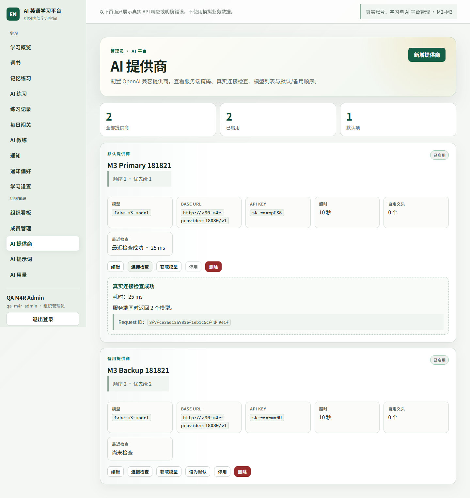
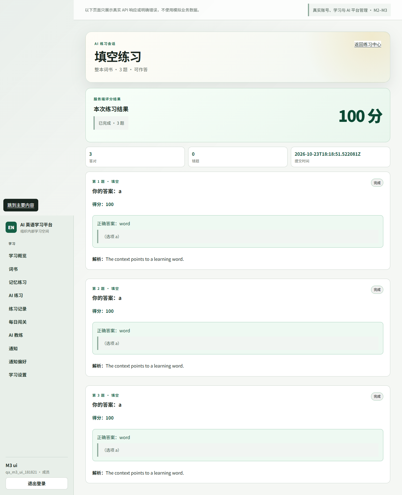
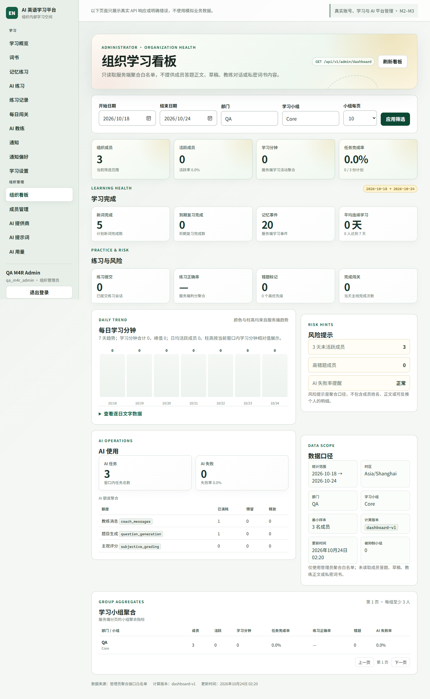
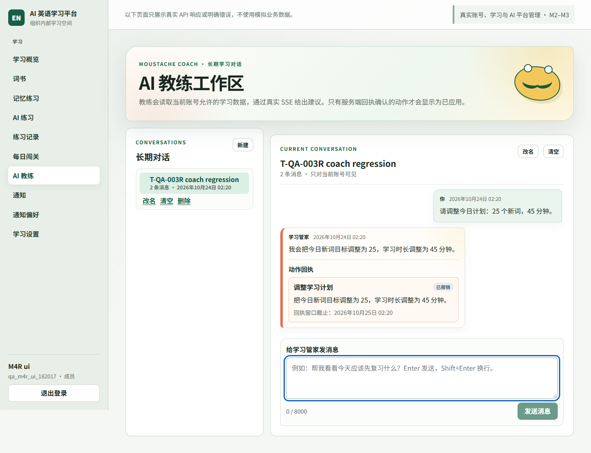
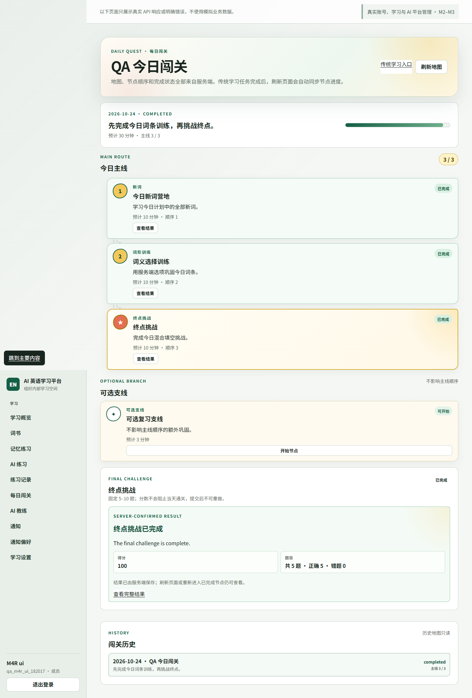

# 演示截图与事实清单

- 来源：T-QA-004 真实浏览器验收，`results/m5-m3-20261024-0235` 与 `results/m5-m4r-20261024-0242`
- 代码基线：`efc6bcbd2679eca02613a7143c68d04dddc36a59`
- 数据性质：合成管理员/成员/词书/练习/对话/挑战数据
- 用途：比赛材料与事实核对；不是稳定 HTTPS 截图，不代表最终 MVP PASS
- 临时公网预览：`http://23.94.141.170:18080`（`v0.1.0`，commit `4ee1a71`；HTTP）
- 预览账号：`demo_admin`、`demo_member`；密码只从 A40 的 ACL 本地凭据文件安全获取，不写入仓库/截图/文档

## 截图清单

| 文件 | 分辨率 | SHA256 | 事实 |
|---|---:|---|---|
| `admin-ai-provider.png` | 1440×1524 | `B1B2EE0B540E2834EC751F7E875D38F6B2A6150A4F7529632037F48F6B05869B` | AI provider 配置、Key 掩码 |
| `admin-ai-prompt.png` | 1440×1296 | `A310FE6DD931A3AAF1AEA311D0EEDCFC3440A095E96FFE00B24F9077C411FB81` | 提示词读取/覆盖 |
| `practice-result.png` | 1440×1771 | `A74BA16E4665A37F3DADC3E958E3EBC95C6BCEC2E9611535B7F0B84C109981B3` | AI 练习提交后结果与解析 |
| `practice-failure.png` | 1440×1000 | `BEAA264745CEC6CA386D49E817D9BF8934B01E4C18F29F879C8934F3B31C5E0E` | provider 失败态、真实错误 |
| `notifications.png` | 1440×1288 | `226FBA18E400C0A039E6AE85E4372E38E24D1F3832D342AE1D50C4D0D20CCCEE` | 通知收件箱与未读 |
| `dashboard-aggregate.png` | 1440×2335 | `E85EA6FF7B831190BA18E81638762D1FE651EE0C1661F8CDF35DFFA5B1FB5A3F` | 组织聚合看板 |
| `coach-action.png` | 1440×1105 | `A50D65FE624A03B211ABC444EED4BC20FE8F445A1A02BD64235C82EDA4713DB4` | 教练 SSE 与 action receipt |
| `challenge-boss-result.png` | 1440×2129 | `79F446C899FD6B8F9B7161C9380108AC2951A5C39E7DAD232DD413269B87AD16` | BOSS 结果可见 |
| `challenge-boss-reenter.png` | 1440×2535 | `425D9F9CF85EB9E173320ECD250704154628AC889BFEDE2C92AF5055612F9EB6` | 刷新后重入结果 |

## 预览

## 安全与来源

- 截图来自真实浏览器，不是 PPT、mock 或静态页面。
- 使用合成账号和合成词书；QA 审查确认不含密钥、真实成员数据或私有正文。
- 浏览器地址为本地/受控测试地址，不是公网部署 URL。
- 截图不能替代自动化断言；自动化证据在 T-QA-004 的 `browser-acceptance.json` 与 `api-acceptance.json`。
- T-SHIP-002 临时 HTTP 预览已通过；本目录的 9 张图仍是 QA/受控环境截图，不是公网 IP 截图。
- 公网截图需在 A40 ACL 凭据授权下另行捕获，不得把密码、Cookie 或 Token 写入截图或仓库；稳定 HTTPS 截图仍为 TODO。

## 复现

1. 按 [演示数据说明](../demo-data.md) 初始化合成数据。
2. 启动真实 API、worker、scheduler、frontend 和受控 provider。
3. 使用 QA 浏览器脚本或手工流程完成管理员/成员路径。
4. 录制前确认截图不含真实服务器信息、Token 或私密内容。

## 当前限制

- Today 页面 `ai_practice` 仍是旧 `not_available` 字段；截图中 AI 练习从 `/practice` 展示。
- 截图不是最终比赛视频，也不能单独证明稳定 HTTPS、长期生产 SLA 或最终 MVP。
- 预览环境的健康、登录、SSE、备份和机械回滚证据见 T-SHIP-002，不以截图替代。
